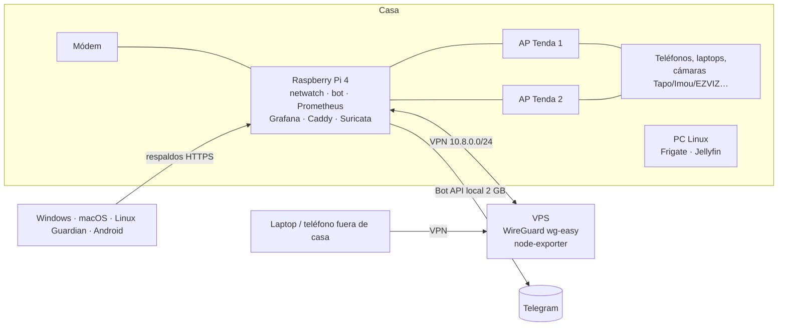

# 🛡 MyHomeLab

La parte de software de mi homelab: monitoreo y seguridad de la red de casa, un bot de
Telegram que recibe respaldos de todos mis equipos y me avisa de lo raro, métricas del
VPS, cámaras, streaming y VPN. Todo en Docker y pensado para crecer: hoy corre en una
**Raspberry Pi 4** + una **PC Linux** + un **VPS**.



## Qué hace (y dónde está)

| Pediste | Cómo quedó | Dónde |
|---|---|---|
| Un solo lugar para todo y sin editar archivos | Web → **Inicio** (todas las herramientas con su estado) y **⚙ Ajustes** (edita `.env` y `homelab.yml`, enciende servicios y aplica cambios) | [ajustes](docs/ajustes.md) |
| Ver dispositivos y tráfico de toda la casa | Escaneo ARP/nmap cada 2 min (sirve con cualquier AP); **varias redes/SSID con una sola Wi-Fi** ([roaming](docs/redes-multiples.md)), tipo de dispositivo por fabricante/puertos, latencias; tráfico **por dispositivo** en modo puente | `services/netwatch`, [modo puente](docs/modo-puente.md) |
| Gráficas en Grafana | Tableros «Red de casa» y «Nodos: Raspberry, PC y VPS» ya cargados | `config/grafana` |
| Detección de anomalías | Dispositivo nuevo, ARP spoofing en el módem/AP, puertos nuevos, tráfico 4–5× arriba de lo normal (casa, VPS y cada dispositivo), IDS Suricata, AP o internet caídos | `monitor.py`, `config/prometheus/rules` |
| ACL | Bloquear por MAC siempre o en un horario (ej. 23:00–07:00), cuarentena automática de desconocidos | web → ACL, `/bloquear` |
| Informe de lo anómalo al bot | Avisos al momento (los no urgentes esperan a que termine el horario de silencio) + reporte diario | `services/bot` |
| Registro de cámaras | Frigate graba y detecta; el bot te manda foto cuando ve una persona/auto | `hosts/server`, [cámaras](docs/camaras.md) |
| Bot: respaldos de Windows, Linux, macOS y teléfono, hasta 2 GB | Cada equipo sube su `.7z` cifrado a la Pi; se guarda por dispositivo, se borran los viejos y se te reenvía por tu Bot API local | `clients/`, [respaldos](docs/respaldos.md) |
| Solo mi ID usa el bot | `TELEGRAM_ALLOWED_IDS`; a cualquier otro se le ignora y a ti te llega aviso | `.env` |
| Estado y tráfico del VPS en Grafana y reportes | node-exporter del VPS por la VPN; `/vps` y reporte diario | `hosts/vps` |
| Publicar en redes de la empresa a cierta hora | `/programar` para Facebook, Instagram y tu canal de Telegram | [redes sociales](docs/redes-sociales.md) |
| App web | Resumen, Dispositivos, Tráfico, Por AP, **Mapa** (árbol Internet → módem → AP → dispositivos), Cámaras, Accesos de un clic a tus AP, ACL y Eventos | `https://IP-de-la-Pi` |
| IPs entrantes | Web → **Conexiones**: grafo interactivo de quién se conecta a qué servicio (permitidas y bloqueadas por UFW), por hora y por IP | [conexiones](docs/conexiones.md) |
| Hostnames y buscar equipos | DNS del módem/Tenda, mDNS, NetBIOS y AdGuard; botón «🔎 Buscar en la red» | [conexiones](docs/conexiones.md) |
| DNS con filtro | AdGuard Home (perfil `dns`), aviso de dominios de malware | [dns](docs/dns.md) |
| Uptime Kuma y Vaultwarden | perfil `servicios` | [servicios](docs/servicios.md) |
| CrowdSec del VPS | métricas y alerta de ataques | [VPN](docs/vpn.md) |
| VPN en el panel | Web → **VPN**: lee tu WireGuard, detecta el VPS, crea equipos con QR y comandos para el VPS, alerta si se cae | [VPN](docs/vpn.md) |
| IDS en casa y laboratorio | Suricata en `eth0` y `wlan0` a la vez | [ids](docs/ids.md) |
| Laboratorio CCNA | Containerlab con OSPF y ejercicios | [lab/](lab/README.md) |
| Streaming propio | **Cine en casa** (`:8097`): portal tipo Netflix con perfiles de la familia, seguir viendo, siguiente episodio, búsqueda y reproductor propio; se maneja con el control de la tele, mouse o dedo. Por dentro, Jellyfin | [streaming](docs/streaming.md) |
| VPN | Reutiliza tu túnel WireGuard Pi ↔ VPS; wg-easy opcional para teléfono/laptop | [VPN](docs/vpn.md) |
| Cuentas para toda la casa | Web → **Cuentas**: administrador, «ve registros» (lo das tú) y familia (solo sus respaldos); aviso si alguien entra desde un equipo nuevo | [seguridad](docs/seguridad.md) |
| Respaldos de la familia sin saber de computadoras | Web → **Mis respaldos**: instalador ya configurado (Windows doble clic, Linux/Mac un comando), subir fotos desde el celular, Telegram opcional; cada quien recibe solo sus avisos | [respaldos de la familia](docs/respaldos-familia.md) |
| Firewall y SSH con llave | `./hl firewall --solo-llave`: SSH solo desde tus 3 equipos del laboratorio y solo con llave | [seguridad](docs/seguridad.md) |
| Respaldo del propio homelab | `./hl respaldo` cifrado (cada domingo): SSD + Telegram (+ VPS); `./hl restaurar` en una Pi nueva | [respaldos](docs/respaldos.md#respaldo-del-homelab) |
| Diagnóstico y actualizar | `./hl revisar` / `./hl actualizar`, o Web → **Sistema** | [hl](#el-comando-hl) |
| Estado de servicios y resumen diario | Web → **Servicios** (Uptime Kuma), resumen por Telegram a tu hora, horario de silencio | [servicios](docs/servicios.md) |
| Cámaras genéricas (foco 360°) | Web → Cámaras → «Detectar cámara genérica» (iCSee, V380, Yoosee, CamHi) | [cámaras](docs/camaras.md#cámaras-genéricas-foco-360) |
| Fotos de la familia | **Immich** en la Pi o la PC (`:2283`): la app del celular sube las fotos sola; cada quien su cuenta; se muda a la PC con un comando | [fotos](docs/fotos.md) |
| No-break | `./hl nobreak`: aviso por Telegram si se va la luz, apagado en orden de PC y Pi, tarjeta en Inicio | [no-break](docs/no-break.md) |
| Inicio de sesión único | `./hl sso`: Authelia en `panel.casa.lan`, 2FA para administradores, mismas cuentas del panel | [sso](docs/sso.md) |
| Laboratorio de seguridad | Wazuh (SIEM) + DVWA, Juice Shop y Metasploitable en una red aislada, Kali y prácticas | [laboratorio de seguridad](docs/laboratorio-seguridad.md) |
| Velocidad del internet, imágenes nuevas, encender la PC | Speedtest Tracker, Diun, Wake-on-LAN (`/encender`) | [servicios](docs/servicios.md#speedtest-tracker--httpip-de-la-pi8765) |
| Prueba de restauración | `./hl probar-respaldo` (cada mes): descifra y revisa el último respaldo | [servicios](docs/servicios.md#prueba-mensual-del-respaldo) |
| Mudarse a la PC / limpiar la Pi | `./hl migrar` (desde cero o copiando de la Pi por SSH con llave) y `./hl limpiar` | [migrar](docs/migrar.md) |

## Instalación

### 1. Raspberry Pi 4 (Raspberry Pi OS **64 bits**)
```bash
git clone https://github.com/JohnKun136NVCP/MyHomeLab && cd MyHomeLab
./scripts/install-pi.sh          # Docker, secretos (.env), y levanta todo
```
Antes de terminar edita:
- `.env`: `TELEGRAM_BOT_TOKEN`, `TELEGRAM_ALLOWED_IDS` (tu ID primero), `TELEGRAM_API_URL`
  (tu servidor Bot API, p. ej. `http://host.docker.internal:8081`) y `HOMELAB_HOST` (IP de la Pi).
- `config/homelab.yml`: tu red (`cidr`, `gateway`), las IP de tus 2 AP Tenda y del módem,
  tus dispositivos de respaldo y las redes sociales.

Luego `./hl actualizar` (o `./hl up -d`) cada vez que cambies algo a mano; desde la web, Ajustes → «Guardar y aplicar».

Entra a **https://IP-de-la-Pi:PUERTO** con usuario `admin` y la contraseña que pusiste. Grafana está en `/grafana/`.

#### El comando `hl`
Atajo dentro del repo (siempre con `--env-file .env`, sin avisos `WARN`):

**`./hl` solo abre un menú** con todo (estado, servicios opcionales, fotos, respaldos, seguridad,
no-break, laboratorio, mudanza). Cada opción te muestra el comando que corre, por si luego lo
quieres usar directo.

| Comando | Qué hace |
|---|---|
| `./hl` | menú con todas las herramientas |
| `./hl servicios encender speedtest` | enciende/apaga opcionales: dns, servicios, ids, speedtest, diun |
| `./hl fotos diagnostico` | Immich: `estado`, `diagnostico`, `abrir-firewall`, `actualizar` |
| `./hl estado` | contenedores y si están sanos |
| `./hl revisar` | diagnóstico completo con el arreglo de cada problema |
| `./hl actualizar` | `git pull` + reconstruye + levanta |
| `./hl reiniciar [svc]` / `./hl logs [svc]` | reiniciar / ver bitácora |
| `./hl firewall [--solo-llave]` | reglas de UFW y SSH solo con llave |
| `./hl respaldo` / `./hl restaurar ARCHIVO` | respaldo cifrado del homelab |
| `./hl contraseña` | nueva contraseña del admin de la web |
| `./hl ca` | certificado de Caddy para instalar en tus equipos |
| `./hl <lo que sea>` | se pasa a `docker compose` (`ps`, `exec`, `pull`…) |

Tip: `echo "alias hl='~/MyHomeLab/hl'" >> ~/.bashrc` y lo usas desde cualquier carpeta.

> Tu servidor Bot API debe correr con `--local` y su carpeta de datos estar en
> `TELEGRAM_API_DATA`: así el bot lee los archivos de hasta 2 GB que le mandas desde el
> teléfono. Usa el **mismo token** que ya tienes: el bot solo envía y recibe con él
> (ver [bot](docs/bot.md) sobre `getUpdates` si otro programa ya lee las actualizaciones).

### 2. PC Linux (cámaras y streaming)
```bash
git clone https://github.com/JohnKun136NVCP/MyHomeLab && cd MyHomeLab
./scripts/install-server.sh
```
Instala Docker, detecta tu GPU, levanta Frigate + Jellyfin + métricas, pone el firewall,
se registra sola en la Pi y programa su respaldo semanal. Detalles en [docs/servidor.md](docs/servidor.md).

### 3. VPS
```bash
docker compose -f hosts/vps/docker-compose.yml --env-file .env up -d
```
Con tu túnel WireGuard existente basta poner `VPN_VPS_IP` en `.env` (solo métricas).
Para una VPN nueva con web y QR: `--profile wg-easy`. Detalles en [docs/vpn.md](docs/vpn.md).

### 4. Equipos que se respaldan
| Equipo | Cliente |
|---|---|
| Linux | `clients/linux-guardian` (GUI) → pestaña Telegram → «Mi homelab» |
| Windows | `clients/windows/Respaldo-Homelab.ps1 -Configurar` y `-Programar` |
| macOS | `clients/macos/respaldo-homelab.sh --configurar` y `--programar` |
| Android | `clients/android/respaldo-termux.sh` (Termux) o mándale archivos al bot |

## Comandos del bot
`/estado` · `/reporte` · `/vps` · `/dispositivos` · `/nuevos` · `/eventos` · `/bloquear MAC [23:00-07:00]` ·
`/acl` · `/desbloquear ID` · `/encender [nombre]` · `/conexiones` · `/dns` · `/camaras` · `/foto NOMBRE` · `/respaldos` ·
`/programar FECHA HORA fb,ig,tg texto` · `/programadas` · `/cancelar ID` · `/publicar_ya ID`.
Cualquier archivo, foto o video que le mandes se guarda como respaldo del teléfono
(`#nombre` en el pie para otro dispositivo).

## Estructura
```
hosts/          docker-compose por equipo (pi, server, vps)
config/         homelab.yml, Prometheus + reglas, Alertmanager, Grafana, Caddy, Frigate
services/       netwatch (red + web) y bot (Telegram + respaldos), Python sin frameworks pesados
clients/        Linux Guardian, Windows, macOS, Android
scripts/        instalación, secretos, modo puente, VPN, generador de tableros
docs/           guías por tema
tests/          pytest (incluye un Telegram y una Graph API falsos)
```

## Límites honestos
- **Sin modo puente** la Pi solo ve su propio tráfico: la lista de dispositivos, latencias y
  anomalías ARP sí funcionan, pero el tráfico por dispositivo, Suricata completo y los
  bloqueos ACL necesitan que la Pi esté entre el módem y los AP ([modo puente](docs/modo-puente.md)).
- **En qué AP está cada dispositivo** no se puede saber por ARP y los Tenda no tienen API:
  se asigna en la web (Dispositivos → AP) y de ahí salen el mapa y «Por AP».
- La Pi 4 aguanta bien la red, el bot y Grafana; Frigate con detección y Jellyfin
  transcodificando van en la PC.

## Pruebas
```bash
pip install pytest starlette uvicorn pyyaml
python -m pytest tests/ -q
```
