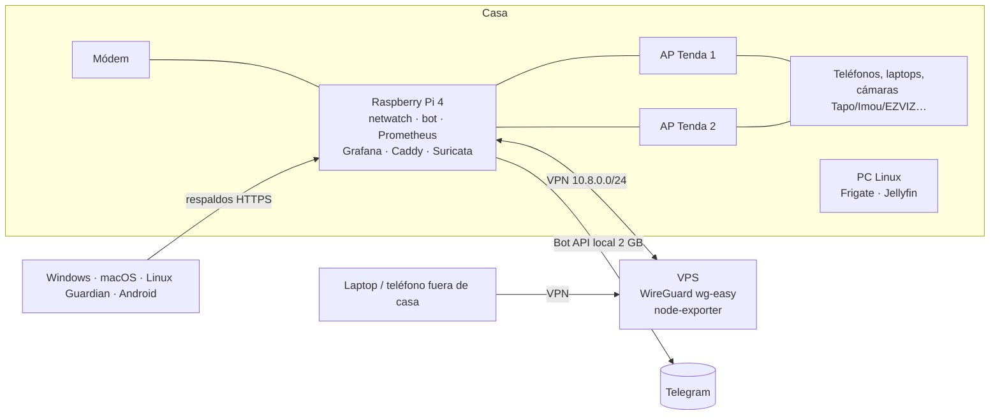

# 🛡 MyHomeLab

La parte de software de mi homelab: monitoreo y seguridad de la red de casa, un bot de
Telegram que recibe respaldos de todos mis equipos y me avisa de lo raro, métricas del
VPS, cámaras, streaming y VPN. Todo en Docker y pensado para crecer: hoy corre en una
**Raspberry Pi 4** + una **PC Linux** + un **VPS**.



## Qué hace (y dónde está)

| Pediste | Cómo quedó | Dónde |
|---|---|---|
| Ver dispositivos y tráfico de toda la casa | Escaneo ARP/nmap cada 2 min (sirve con cualquier AP), tipo de dispositivo por fabricante/puertos, latencias; tráfico **por dispositivo** en modo puente | `services/netwatch`, [modo puente](docs/modo-puente.md) |
| Gráficas en Grafana | Tableros «Red de casa» y «Nodos: Raspberry, PC y VPS» ya cargados | `config/grafana` |
| Detección de anomalías | Dispositivo nuevo, ARP spoofing en el módem/AP, puertos nuevos, tráfico 4–5× arriba de lo normal (casa, VPS y cada dispositivo), IDS Suricata, AP o internet caídos | `monitor.py`, `config/prometheus/rules` |
| ACL | Bloquear por MAC siempre o en un horario (ej. 23:00–07:00), cuarentena automática de desconocidos | web → ACL, `/bloquear` |
| Informe de lo anómalo al bot | Avisos al momento (los no urgentes esperan a que termine el horario de silencio) + reporte diario | `services/bot` |
| Registro de cámaras | Frigate graba y detecta; el bot te manda foto cuando ve una persona/auto | `hosts/server`, [cámaras](docs/camaras.md) |
| Bot: respaldos de Windows, Linux, macOS y teléfono, hasta 2 GB | Cada equipo sube su `.7z` cifrado a la Pi; se guarda por dispositivo, se borran los viejos y se te reenvía por tu Bot API local | `clients/`, [respaldos](docs/respaldos.md) |
| Solo mi ID usa el bot | `TELEGRAM_ALLOWED_IDS`; a cualquier otro se le ignora y a ti te llega aviso | `.env` |
| Estado y tráfico del VPS en Grafana y reportes | node-exporter del VPS por la VPN; `/vps` y reporte diario | `hosts/vps` |
| Publicar en redes de la empresa a cierta hora | `/programar` para Facebook, Instagram y tu canal de Telegram | [redes sociales](docs/redes-sociales.md) |
| App web | Resumen, Dispositivos, Tráfico, Por AP, **Mapa** (árbol Internet → módem → AP → dispositivos), Cámaras, Accesos de un clic a tus AP, ACL y Eventos | `https://IP-de-la-Pi` |
| Streaming propio | Jellyfin en la PC | `hosts/server` |
| VPN | WireGuard (wg-easy) en el VPS: funciona aunque tu internet tenga CGNAT | [VPN](docs/vpn.md) |

## Instalación

### 1. Raspberry Pi 4 (Raspberry Pi OS **64 bits**)
```bash
git clone https://github.com/JohnKun136NVCP/MyHomeLab && cd MyHomeLab
./scripts/install-pi.sh          # Docker, secretos (.env), y levanta todo
```
Antes de terminar edita:
- `.env`: `TELEGRAM_BOT_TOKEN`, `TELEGRAM_ALLOWED_IDS` (tu ID primero), `TELEGRAM_API_URL`
  (tu servidor Bot API, p. ej. `http://host.docker.internal:8081`) y `HOMELAB_HOST` (IP de la Pi).
- `config/homelab.yml`: tu red (`cidr`, `gateway`), las IP de tus 2 AP Tenda y del módem,
  tus dispositivos de respaldo y las redes sociales.

Luego `docker compose -f hosts/pi/docker-compose.yml --env-file .env up -d` cada vez que cambies algo.

Entra a **https://IP-de-la-Pi** (usuario/contraseña de `.env`). Grafana está en `/grafana/`.

> Tu servidor Bot API debe correr con `--local` y su carpeta de datos estar en
> `TELEGRAM_API_DATA`: así el bot lee los archivos de hasta 2 GB que le mandas desde el
> teléfono. Usa el **mismo token** que ya tienes: el bot solo envía y recibe con él
> (ver [bot](docs/bot.md) sobre `getUpdates` si otro programa ya lee las actualizaciones).

### 2. PC Linux (cámaras y streaming)
```bash
docker compose -f hosts/server/docker-compose.yml --env-file .env up -d
```
Pon la IP de la PC en `infrastructure.nodes`, `cameras.frigate_url` y `links` de `homelab.yml`.

### 3. VPS
```bash
docker compose -f hosts/vps/docker-compose.yml --env-file .env up -d
```
Crea en wg-easy un cliente para la Pi y otro para cada equipo; en la Pi:
`sudo ./scripts/pi-vpn.sh raspberry.conf`. Detalles en [docs/vpn.md](docs/vpn.md).

### 4. Equipos que se respaldan
| Equipo | Cliente |
|---|---|
| Linux | `clients/linux-guardian` (GUI) → pestaña Telegram → «Mi homelab» |
| Windows | `clients/windows/Respaldo-Homelab.ps1 -Configurar` y `-Programar` |
| macOS | `clients/macos/respaldo-homelab.sh --configurar` y `--programar` |
| Android | `clients/android/respaldo-termux.sh` (Termux) o mándale archivos al bot |

## Comandos del bot
`/estado` · `/reporte` · `/vps` · `/dispositivos` · `/nuevos` · `/eventos` · `/bloquear MAC [23:00-07:00]` ·
`/acl` · `/desbloquear ID` · `/camaras` · `/foto NOMBRE` · `/respaldos` ·
`/programar FECHA HORA fb,ig,tg texto` · `/programadas` · `/cancelar ID` · `/publicar_ya ID`.
Cualquier archivo, foto o video que le mandes se guarda como respaldo del teléfono
(`#nombre` en el pie para otro dispositivo).

## Estructura
```
hosts/          docker-compose por equipo (pi, server, vps)
config/         homelab.yml, Prometheus + reglas, Alertmanager, Grafana, Caddy, Frigate
services/       netwatch (red + web) y bot (Telegram + respaldos), Python sin frameworks pesados
clients/        Linux Guardian, Windows, macOS, Android
scripts/        instalación, secretos, modo puente, VPN, generador de tableros
docs/           guías por tema
tests/          pytest (incluye un Telegram y una Graph API falsos)
```

## Límites honestos
- **Sin modo puente** la Pi solo ve su propio tráfico: la lista de dispositivos, latencias y
  anomalías ARP sí funcionan, pero el tráfico por dispositivo, Suricata completo y los
  bloqueos ACL necesitan que la Pi esté entre el módem y los AP ([modo puente](docs/modo-puente.md)).
- **En qué AP está cada dispositivo** no se puede saber por ARP y los Tenda no tienen API:
  se asigna en la web (Dispositivos → AP) y de ahí salen el mapa y «Por AP».
- La Pi 4 aguanta bien la red, el bot y Grafana; Frigate con detección y Jellyfin
  transcodificando van en la PC.

## Pruebas
```bash
pip install pytest starlette uvicorn pyyaml
python -m pytest tests/ -q
```
